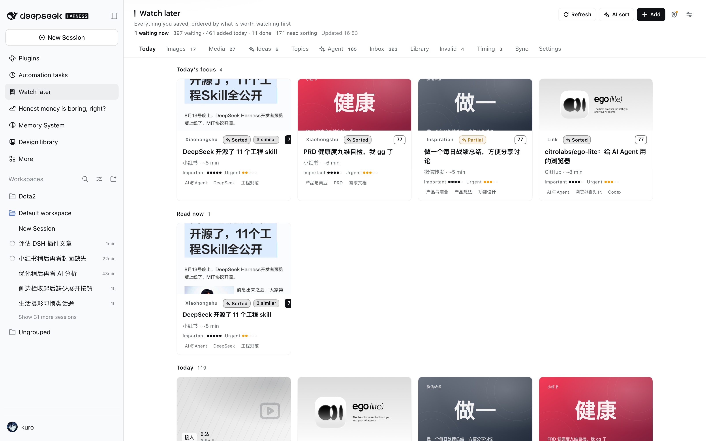
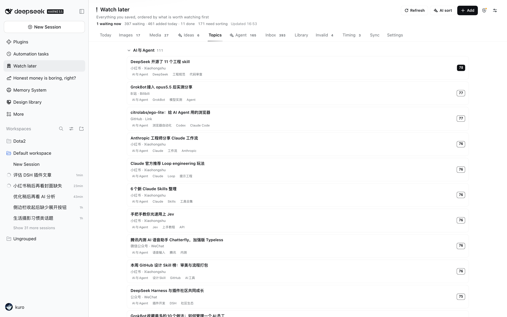

# 稍后再看 · DSH 侧边栏稍后再看中心

把每天从微信文件传输助手攒下来的图片、小红书文章、微信公众号文章、链接、剧名，
统一收进 DSH 侧边栏：按 12 类归档，按**重要程度 + 紧急程度 + 时效**打分，
对开播 / 上映 / 优惠截止这类内容倒计时提醒，并把 **B站 / 抖音的「稍后再看」**同步进来。





## 功能

| 能力 | 说明 |
|---|---|
| **统一收件箱** | 图片、公众号/小红书文章、链接、剧名、B站/抖音视频进同一个队列 |
| **12 类固定分类** | AI与Agent / 设计 / 产品与商业 / 投资与量化 / 游戏 / 影游 / 摄影 / 生活与健康 / 成长与职业 / 工具与数码 / 截图存档 / 待归档 |
| **三维打分** | 重要度、紧急度、时效各 1–5；倒计时显示「剩 6 小时」，过期单独归档 |
| **AI 整理** | 抓正文 → 补真封面 → 模型判类型/分类/标题/摘要；逐条判定「已整理/部分/失败」，可撤销 |
| **内容直读** | 抽屉里直接看正文和图片、B站内嵌播放器；抓不到时显示真实原因，不假装有正文 |
| **相似内容合并** | 标题相近的自动归组只留一篇，可让模型给 2–3 句归纳并推荐先看哪篇 |
| **影游清单** | 从文章提取作品名 → Bangumi 查标准标题/海报/简介，做成海报墙 |
| **Agent 库** | 插件 / skill / 提示词单独收拢，「尝试一下」新建会话并预填提示词 |
| **图片专区** | 截图单独大图网格，可批量「加入设计素材库」 |
| **同步** | B站、抖音「稍后再看」导入，扫码登录，不覆盖手改过的字段 |

面板 tab：`Today` / `Images` / `Media` / `Ideas` / `Topics` / `Agent` / `Inbox` / `Library` / `Invalid` / `Timing` / `Sync` / `Settings`。

## 安装

**要求**：DeepSeek Harness（`>= 0.2.0-rc.1`）、Node.js `>= 22.19`。

```bash
# 1. 克隆到 DSH 工作区
git clone https://github.com/maqkuro/dsh-watch-later.git \
  ~/Documents/deepseek-harness/default-workspace/dsh-watch-later

# 2. 加进你的 profile（把 desktop 换成实际的 profile 名）
dsh plugin --profile desktop add \
  ~/Documents/deepseek-harness/default-workspace/dsh-watch-later
```

装完**刷新一次 DSH 页面**，左侧栏即出现「Watch later / 稍后再看」入口。
首次打开会自动建目录，不需要额外配置。

> ⚠️ **包名必须是 `@local/` 前缀**。DSH 桌面端只挂载 `@local/` 工作区插件；
> 改成其他 scope 后 bundle patch 里的 `name` 解析不到，插件整个不挂载
> （表现为侧边栏没有入口、`watch_later_*` 工具不可用）。

**卸载**：在 DSH 插件管理里移除 `@local/dsh-watch-later` bundle。数据目录不会自动删除，
要彻底清理需手动删 `~/.dsh/storages/watch-later/`。

## 四条入库路径

**0. macOS 分享（推荐）** —— 微信/系统分享面板选「DeepSeek Harness」，
可一次多选图片、文字、链接，也可直接分享聊天记录 ZIP（上限 512 MiB）。失败会写明原因并保留原包。

**1. 转发给 DSH 助手（最常用）** —— 把内容粘贴/转发给 DSH，说一句「稍后再看」或直接转发不提问，
助手会调用 `watch_later_save`，按内容判断类型、重要度、紧急度后入库。

**2. 面板右上角「+ Add」** —— 链接 / 粘贴文本（可一次多条）/ 上传图片，自动抓标题和封面。

**3. 投递目录（免对话）** —— 把文件丢进 `~/.dsh/storages/watch-later/inbox/`：

| 文件类型 | 处理方式 |
|---|---|
| `png/jpg/webp/gif` | 建图片条目 |
| `.txt` / `.md` | 解析里面的链接，一条链接一个条目 |
| `.json` | 按条目数组导入（也接受 `items` 字段） |
| `.url` / `.webloc` | 书签链接 |

处理完自动移到 `inbox/done/`。

## 打分与时效

- **重要程度 1–5**：和在办的事 / 钱 / 健康 / 家人的相关度（5 = 直接相关）
- **紧急程度 1–5**：不马上看会不会错过、失效、过期（5 = 今天不做就损失）
- **时效 deadline**：只有内容里出现明确时间才填（开播 / 上映 / 优惠截止 / 活动 / 剧集更新）
- **综合分（0–100）** = 45% 重要度 + 35% 紧急度 + 20% 时间压力，
  分「现在就读 / 今天内 / 本周 / 以后 / 已过期」五档；今日页只把前两档推上来

## 同步

**B站**：面板「Sync」→ B站卡片 → 扫码登录 → 自动取 `SESSDATA` 等 Cookie → 立即同步。
只新增/刷新视频元数据（标题、封面、时长、UP 主），**不覆盖**你手改过的状态、分数、截止时间和笔记。

**抖音**：面板「Sync」→ 抖音卡片 → 打开登录窗口（独立 profile 的 Chrome）→ 登录后经 CDP 读 Cookie → 同步。
两个平台都保留「手动粘贴 Cookie」兜底。

## Agent 工具

| 工具 | 用途 |
|---|---|
| `watch_later_save` | 批量存入并打分（含 `imagePaths` 本地图片入库） |
| `watch_later_list` | 查队列（today / inbox / expired / kind / all） |
| `watch_later_update` | 改状态 / 分数 / 截止 / 标签 / 笔记 / 稍后提醒 |
| `watch_later_sync` | 触发 B站 / 抖音同步 |
| `watch_later_ingest_zip` | 手动导入微信聊天记录 ZIP 原包 |
| `watch_later_ai_review` | 让模型读正文后重新整理分类 / 分数 / 摘要 |

插件同时注册了一段系统提示词，所以「转发 → 存入 → 打分」不需要额外说明语法。

## 数据与隐私

```
~/.dsh/storages/watch-later/
├── items.json       # 全部条目（原子写）
├── media/           # 本地封面 / 图片
├── inbox/           # 投递目录（+ done/ 已处理）
├── secrets.json     # 平台 Cookie（0600，接口不回显明文）
└── sync-state.json  # 最近一次同步状态
```

**所有内容只存在本机**，不向任何第三方服务器上传。唯一的对外请求是抓取原文、封面，
以及你主动触发的平台同步。面板「Settings」可关闭「同步后自动 AI 整理」、调整完成后保留天数、导出 JSON。

分类/类型是**高置信才改**（confidence ≥ 0.7），拿不准只在 `ai.suggest` 里留建议；
标题只做清洗补全，不改事实，原标题保留在 `titleRaw`。

## 公众号正文（可选增强）

微信对部分公众号文章做了文章级风控，非微信客户端会 302 到验证页（「环境异常」）。
本插件支持挂一条**真浏览器兜底通道**：装上 [Tencent/BrowserSkill](https://github.com/Tencent/BrowserSkill)
（`bsk` CLI + 浏览器扩展）后，被拦的文章会用你已登录的 Chrome 打开、点一次「去验证」放行后取回正文。

没装也能正常用——只是这类文章退化成「标题 + 摘要 + 打开原文」，不报错。

## 已知限制

| 平台 | 限制 |
|---|---|
| **小红书** | 不做登录抓取；按 IP 风控，连续抓 100+ 条后会被全站限制，需放缓并熔断退避 |
| **微信公众号** | 被风控拦截时退化为标题+摘要；装了 BrowserSkill 才走浏览器通道取正文 |
| **抖音** | 分享页不登录拿不到标题/作者/封面（只能入库链接）；列表接口需登录 Cookie |
| **图片** | 只以附件形式存在的图片只能存「标题+来源说明」，本体请用「+ Add → 图片」或丢进 `inbox/` |

## 开发与测试

```bash
node --test test/*.test.mjs
```

覆盖评分 / 分类、同步、数据层、分享作业、登录、内容抓取、相似聚类、素材库推送、ZIP 入库、封面补齐。
开发和逐次迭代记录见 [CHANGELOG.md](CHANGELOG.md) 与 [CONTRACT.md](CONTRACT.md)。

## 许可证

[MIT](LICENSE)
